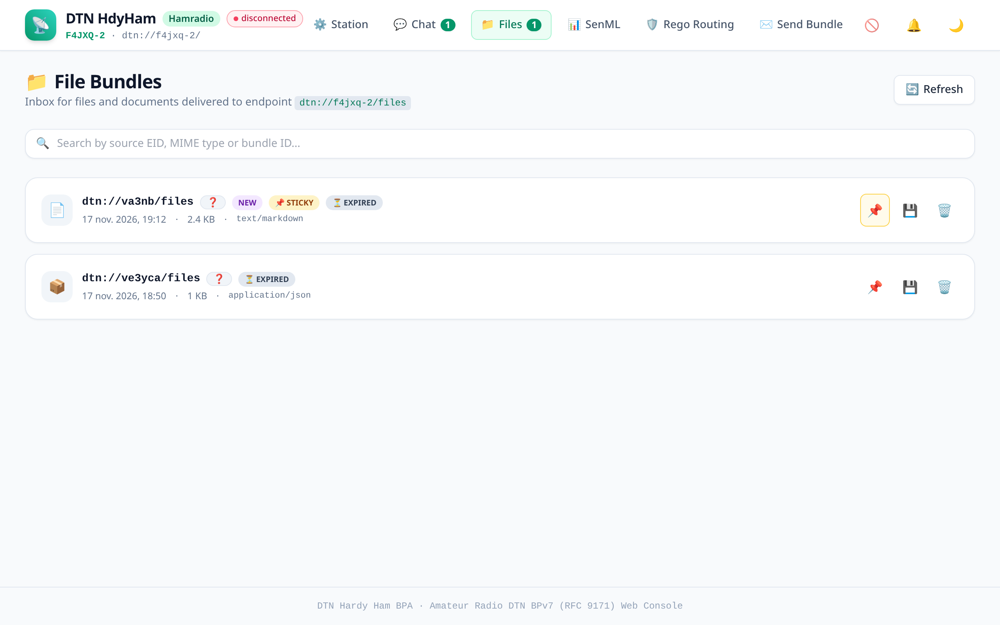

# dtnpm-mod-files

Fullstack **DTN File Transfer** plugin for **DTN Postmaster** (`dtnpm`), implementing `dtnpm_web_core::WebModule`.

## Screenshot



## Features

- **BPA Service (`FilesService`)**: Registers `dtn://<node>/files`, persists incoming file bundles with BPsec auth metadata, and broadcasts real-time SSE notifications.
- **SQLite Persistence**: Provides `migrations/0001_files_schema.sql` (`file_transfers`) over the shared SQLite `Arc<Mutex<Connection>>`.
- **HTTP API (`/api/files/v1/...`)**: Multipart/raw file transmission, received/sent transfer listing, payload download, unread counters, and mark-read endpoints.
- **Standalone Mode**: Includes `dtnpm-mod-files` daemon (`cli` feature) and `examples/test_server.rs`.
- **WebUI Component (`ui/`)**: Preact `<FilesView />` component and Playwright E2E spec.

## Build and Test

Requires sibling checkouts of `../dtnpm-core`, `../dtnpm-web-core`, and `../../hardy/*`.

```bash
cargo test --all-targets
```

Run the standalone mock server example:

```bash
cargo run --example test_server
```

## Security & Compliance

- **BPSec (RFC 9172)**: Strict signature verification by default; rejection of unsigned file bundles and missing keys under `VerifyPolicy::Strict`.
- **Pre-Quota RAM Protection**: Early stream rejection before buffering if `total_len` exceeds remaining storage quota.
- **Filesystem Hardening**: Strict filename sanitization (128 chars, `[A-Za-z0-9_-]`), non-blocking async disk writes (`tokio::fs::write`), and automatic cleanup of orphan files when DB insertion fails.
- **Cyber Resilience Act (CRA)**: Token file security (`--token-file`), lifetime calculation clamping, VEX audit documentation (`RUSTSEC-2026-0459`), and SHA-pinned CI actions.
- **Rust Quality Standards**: 100% `unwrap`-free and `panic!`-free production codebase.
- **Documentation**: See [`AGENTS.md`](AGENTS.md), [`CONTRIBUTING.md`](CONTRIBUTING.md), [`SECURITY.md`](SECURITY.md), and Architectural Decision Records in [`adr/`](adr/).

## License

Dual-licensed under the Apache License, Version 2.0 or the MIT License (crate metadata: `Apache-2.0`). See [LICENSE.md](LICENSE.md).
